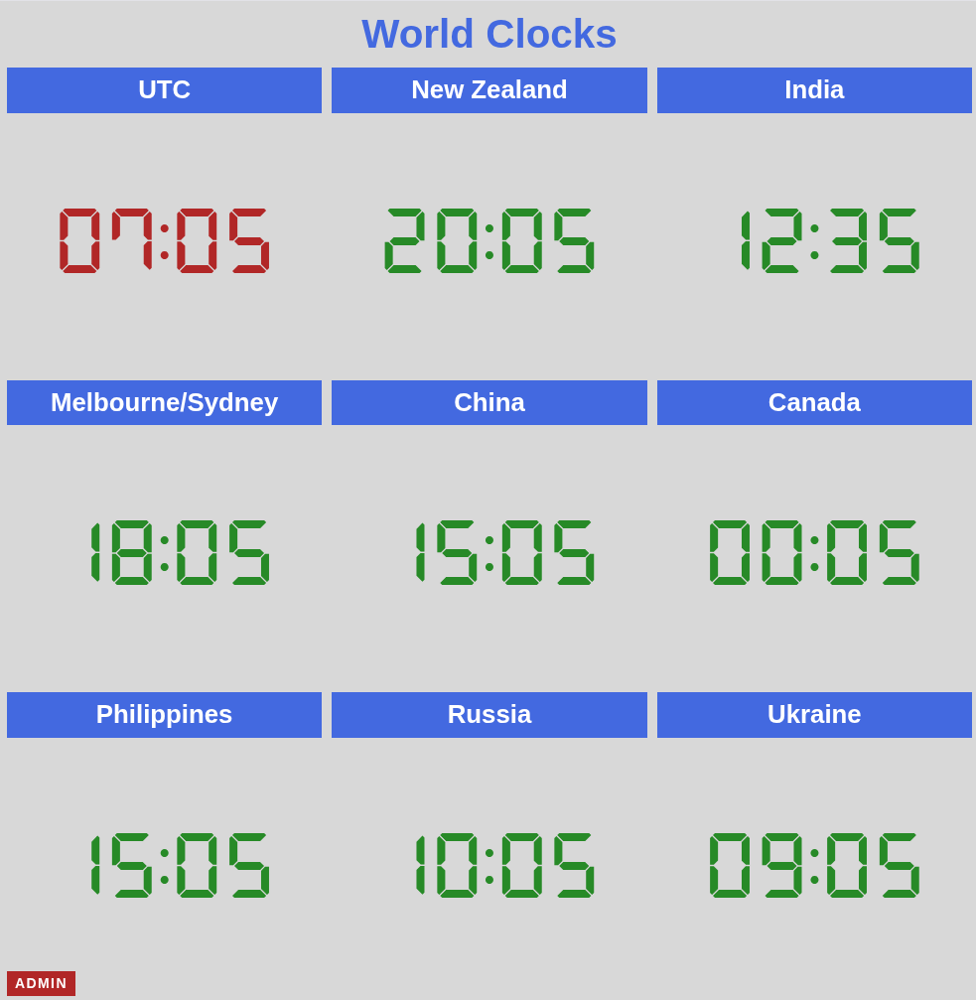
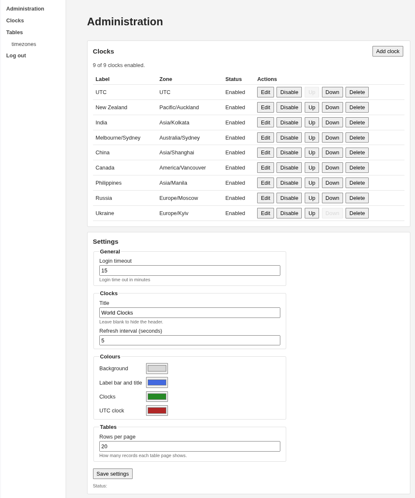

# Noticeboard Display

A Web application written in Go + HTMX + SQLite to mimic the functionality of the United Seafarers Mission World Clock application.

## Features

- A public clocks page showing up to nine world clocks in a 3×3 grid, in 24-hour `HH:MM` time. The UTC clock is red and the other clocks are green. The colours can be changed.
- Live updates: the clocks page refreshes itself at a configurable interval, and shows a STALE indicator if an update fails.
- An administration dashboard, protected by login, for managing the clocks (add, edit, enable or disable, reorder, delete) and the settings (title, colours, refresh interval, table page size, login timeout).
- A paginated, searchable administration table for the `timezones` records behind the clocks, with Edit and Delete per row.
- Each clock's time zone is chosen from a list of IANA zones, so daylight saving is applied automatically.
- Desktop mode: `serve --launch` opens the clocks page in a browser app-mode window, and `open <address>` opens a clocks page that is already running.
- A single self-contained binary. Data is kept in one SQLite file, and building needs no C compiler.
- An audit log of logins and changes made in the administration pages.

#### World clocks



#### Admin dashboard



## Installation

The application is a single executable binary file (about 14MB) containing the application, application resources, a web server and the SQLite database engine. There are no other dependencies. On first run `serve` creates the SQLite database (`./noticeboard.db`) and the audit log (`./noticeboard.log`); both paths can be changed with `serve` options.

See [Development](#development) if you prefer building from source instead of using prebuilt binaries.

### Linux

Download `noticeboard-<release_tag>-linux-amd64` executable from the [Github Releases page](https://github.com/srackham/noticeboard/releases), rename it to `noticeboard` and make it executable with `chmod +x noticeboard`.

### Microsoft Windows

Download `noticeboard-<release_tag>-windows-amd64.exe` executable from the [Github Releases page](https://github.com/srackham/noticeboard/releases), rename it to `noticeboard.exe`.

## Usage

### Create the administrator account

```sh
./noticeboard admin init <username>
```

The username must be one or more printable characters with no spaces. The password is requested twice. It is not echoed, and it is never taken from the command line. Running `admin init` replaces the existing account and ends all existing logins.

### Start the server

```sh
./noticeboard serve
```

The server listens on `127.0.0.1:8080` by default. Then open:

- the clocks page at <http://127.0.0.1:8080/clocks>
- the administration pages at <http://127.0.0.1:8080/admin/login>

Stop the server with Ctrl+c.

### Desktop app mode

To open the clocks page in a local app-mode browser window:

```sh
./noticeboard serve --launch
```

To open a clocks page that is already running, for example on another host machine:

```sh
./noticeboard open dell7090:8080
```

> [!NOTE]
> Use the `0.0.0.0` "any" address to allow other machines on the network to access the server, for example `./noticeboard serve --addr 0.0.0.0:8080`.

## CLI

Executable command syntax: `./noticeboard <command> [<arguments>] [<options>]`

Run `./noticeboard --help`, or `./noticeboard <command> --help`, for the full usage.

### Commands

| Command | Purpose                                               |
| ------- | ----------------------------------------------------- |
| `serve` | Run the web server (public board and admin dashboard) |
| `open`  | Open the board in an app-mode browser window          |
| `admin` | Administration commands                               |

### Options

| Command      | Option        | Default             | Purpose                                                                                                                                |
| ------------ | ------------- | ------------------- | -------------------------------------------------------------------------------------------------------------------------------------- |
| `serve`      | `--addr ADDR` | `127.0.0.1:8080`    | Listen address. Use a VPN address to reach the board from other machines.                                                              |
| `serve`      | `--db FILE`   | `./noticeboard.db`  | SQLite database file. It is created if absent.                                                                                         |
| `serve`      | `--log FILE`  | `./noticeboard.log` | Audit log file.                                                                                                                        |
| `serve`      | `--launch`    | off                 | Open the board in an app-mode browser window. If the address is already in use, open the board at that address and exit with status 0. |
| `admin init` | `--db FILE`   | `./noticeboard.db`  | Database file to create or update.                                                                                                     |

`open` takes the target address as an argument and has no options.

## Routes

See [_Routes_ in the design specification](./docs/DESIGN.md#5-routes).

## Development

### Requirements

- [mise](https://mise.jdx.dev/), which installs the Go version pinned in `mise.toml`. Alternatively, install Go 1.26.6 yourself.
- A host clock kept accurate, for example with NTP. The clocks page shows the host's time.
- Optional: Chrome or Chromium, for the browser tests. Without it those tests skip, as they do with `go test -short ./...`.
- Optional: the [GitHub CLI](https://cli.github.com/) (`gh`), for `mise run release`.

### Build

```sh
mise install
mise run build
```

This produces the `noticeboard` executable. The templates, static files and database migrations are embedded in it, so rebuild after changing them. Without mise, run:

```sh
CGO_ENABLED=0 go build -o noticeboard .
```

For another platform, set `GOOS` and `GOARCH`, for example `GOOS=windows GOARCH=amd64`.

### mise development tasks

Run `mise tasks` to list them.

- `mise run build` builds the `./noticeboard` development binary without CGO. It first runs `tidy` and `test`.
- `mise run test` runs `go vet ./...` and then `go test ./...`, which includes the browser tests. They skip when Chrome or Chromium is not installed.
- `mise run test-short` runs `go vet ./...` and then `go test -short ./...`, which skips the browser tests and takes a few seconds.
- `mise run test-browser` runs only the browser tests (`go test ./internal/web -run InBrowser -count=1 -v`), which drive headless Chrome with `chromedp`.
- `mise run fmt` formats the Go source.
- `mise run tidy` verifies and tidies the Go modules.
- `mise run dist <version>` builds the Linux and Windows (amd64) binaries and their checksum file into `dist/`. The working directory must be clean and the local tag `<version>` must point at `HEAD`; an existing build of the same version is not overwritten.
- `mise run release <version>` publishes the artifacts already built by `dist` for the local tag `<version>` as a draft GitHub release, after verifying their checksums. It pushes the tag and requires the `gh` CLI.

## Security

The server uses plain HTTP only. It has no TLS and no login throttling. Admin sessions do not survive a restart: starting the server logs out any administrator who was signed in, so they must log in again. The admin pages also sign out a browser after a period without user activity (15 minutes by default, set by the Login timeout setting). Run it on a trusted network, such as a VPN, and keep the listen address off public interfaces.
